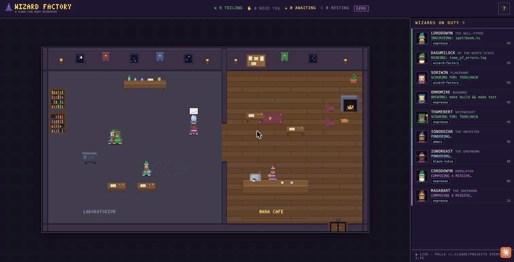

# 🧙 Wizard Factory

A retro 8-bit dashboard that shows every running coding agent in a shared tower.
Local sessions are pixel wizards, agents running remotely on `mage-tower` are demons,
and subagents are apprentices. They work at desks labeled with their task names,
and wait for you at the café with a fresh drink when their turn is done.



## Run

```sh
python3 server.py                  # → http://127.0.0.1:7777
python3 server.py --install-hooks  # one-time: instant "needs permission" alerts (see Hooks)
python3 server.py --demo           # fake wizards, for kicking the tires
python3 server.py --port N         # different port
python3 server.py --remote-host a,b  # watch several machines (empty to watch only this one)
```

Agent polling has no Python dependencies and uses the system `ssh` command. Pull request
CI states need an authenticated `gh` CLI; listening ports need `lsof`. Both are optional.
Usage displays require the `token-quota` CLI and authenticated Codex and Claude CLIs on each
machine; the `token-quota` source checkout is not needed. Configure the accounts to display in
`~/.config/codex-quota/accounts.json` on `mage-tower` (or locally when remote
polling is disabled). A disconnected local Codex home does not add a usage bottle.

## How it works

The server tails local transcript files written to
`~/.claude/projects/<project>/<session>.jsonl` (and
`<session>/subagents/agent-*.jsonl` for subagents), keeping byte offsets per file
and re-reading the tail if a file is rewritten. It also watches the same paths on
`mage-tower` through one long-lived SSH session: the server pipes itself to the remote
`python3`, which scans incrementally and streams a snapshot back whenever something changes
(and every 30 seconds regardless). The session reconnects after a drop and closes when the
dashboard stops. Remote agents are namespaced and displayed as demons; with several hosts, each
later host's demons wear their own colors and duel the others. OpenAI Codex
CLI sessions are tracked the same way from `~/.codex/sessions/**/rollout-*.jsonl` —
they appear as hooded agents with a `codex` chip, and one-shot `codex exec` runs (including
codex review subagents) finish and leave instead of waiting for input. Codex subagents are
titled by their task name; Codex encrypts the messages between its agents, so their text is not
shown. From the
last few events it infers a status for each agent:

| status     | meaning                                   | where the wizard goes        |
|------------|-------------------------------------------|------------------------------|
| working    | a tool call is in flight                  | a personal task desk |
| thinking   | tool result landed / prompt being chewed  | task desk, `…` bubble        |
| responding | writing the final answer                  | task desk, quill bubble      |
| waiting    | turn ended, your move                     | café, fresh drink in hand    |
| attention  | needs permission (hooks mode only)        | petition board, red `!`      |
| idle       | waiting 15+ min                           | hearth armchairs, `Z` (after any game) |
| done       | subagent finished                         | celebrates, exits the door   |

Shell commands are classified by their most significant step (read, search, test,
lint, build, serve, cloud, query, commit, push, wait, and so on), ignoring `cd`, environment
assignments, quoted strings, and heredoc bodies. Polling commands (`until …; do sleep 30`,
`gh pr checks --watch`, `tail -f`) count as waiting for a run; only commits, pushes, and pull
request changes count as submitting.

Working wizards summon a desk and remain seated through tool calls, thinking, and
replies, including long-running commands and tests. The desk dissolves when they
leave to wait or finish. Labels use the session name set by `/rename`, falling back
to the task or project; hover over a wizard to read a longer label. Apprentices get
smaller desks in the nearest available space to their parent. Explicit questions
send wizards to the café while they wait for an answer.

Each desk has a personal sigil: orbiting glyphs mark reading, woven lines mark
writing, and faster rotation marks running commands. Lit runes reflect observed
tool activity rather than percentage complete. Questions leave an open, breathing
ring at the café; finished turns align their sigils into rising gold seals.
Newly active apprentices and remote agents materialize through the summoning circle.
Delegation and returned results send brief pulses between agents; hover or select
an agent to keep its apprentice connections visible. Sessions already present
when the page opens start at their stations without an arrival ceremony.
The laboratory reserves floor space around the cauldron to keep its circle visible.
Biggles can accidentally summon Lucipurr by sitting in the circle, and Earl Grey's
landings briefly scatter nearby runes.

Each desk carries a candle that burns down as the agent's context window fills (Claude
usage over a 1M-token window; Codex usage over its reported window) and is relit by
compaction. Sparks around a busy wizard show reasoning effort: gold for max, violet for xhigh,
blue for high. The journal header lists model, effort, context, lines added and removed, cost,
and turns, along with pull request chips and links to any servers the agent's processes
listen on. Pull request chips open Graphite and are colored by CI state from `gh pr view`,
refreshed every minute: green passing, gold pending, red failing, violet merged. A wizard
running the `pr-watch` skill reads "WATCHING PR".

Paper birds carry messages between agents: Claude `SendMessage` calls (to subagents, sessions,
or named agents), Codex `send_message`, `followup_task`, and `send_message_to_thread` calls, and the tower's own
`continue` after a usage limit. Each appears in both agents' quest history. Two agents that
edited the same file within 30 minutes are joined by crossed wands, with a roster chip naming
the other; a parent and its own apprentice are exempt.

Appearance and name are deterministic per agent id (seeded hats, beards, robes,
staffs, and cafe order), so the same session keeps the same wizard
across reloads. Long quiet stretches are occasionally interrupted by a ray duel;
victims burst through faction-colored shock sigils, then
magically reconstitute amid orbiting motes and reforming circles before returning
to work, followed by a three-to-five-minute cooldown. Each duel has one attacker
and one target. Wizards and demons can call on their own apprentices; stronger defending support
reflects the blast at the aggressor, while a tie still hits the target. Agents
rarely challenge Earl Grey; those who do may bring their apprentices, but he roasts each
assailant into soot in succession. Biggles and Lucipurr bypass duels and can
blast anyone, including Earl Grey, but are themselves immune. Earl Grey, the dragon
barista, brews cafe orders with fire and pours milk for milk drinks. He sleeps when
the factory is empty, roasts beans while agents are active, and flies alert near the
petition board when an agent needs attention.
Waiting wizards play games in the café. Go tables replay professional 19x19 games from the NHK Cup,
televised since 1953, from
[Andries Brouwer's public-domain database](https://homepages.cwi.nl/~aeb/go/games/);
`python3 make_go_games.py` regenerates `static/go-games.js` from it. Badminton and ping pong
rallies last under a minute, while Go and Magic play to their conclusion: a player leaves early
only when their agent goes back to work, needs attention, or ends, and an agent that goes idle
finishes its game before dozing by the hearth.

The long table at the foot of the café hosts Magic: The Gathering duels between two wizards, or
a wizard and Biggles. Each 30-card deck takes the colour of the wizard's robe and of the agent's
most-used tools (Bash red, reading and searching blue, editing green, delegation white). Demons
play black, and only they summon Lord of the Pit; Biggles plays white, led by Savannah Lions.
`static/magic.js` runs a rules subset over about thirty classic cards (mana from lands, Llanowar
Elves, Birds of Paradise, Dark Ritual and Black Lotus; the stack, with Counterspell; combat with
flying, vigilance, trample and Giant Growth) until a player reaches zero life. Cast cards float
above the table, creatures stand on their cards and fight across the mat, d20s keep the life
totals, and the duelists talk across the table. A disputed counterspell can summon Biggles as
judge, a Shivan Dragon sometimes flies a lap of the café while Earl Grey watches, and about one
duel in thirty opens with Black Lotus, Channel and Fireball. Hover over the table for both decks,
the turn, and the last card played.

The frontend polls `/api/state` every 1.5s.

The laboratory's crystals show local and remote CPU, memory, and disk usage,
from top to bottom, filled in red, dark blue, and green against light blue empty
glass. `LOC` and `REM` identify the machines. Hover for the percentage, logical
core count, or used/total capacity. Memory use excludes reclaimable cache; disk
usage covers the filesystem containing the machine's home directory. Above 75%
the crystals flare and throw sparks. If the remote machine is temporarily unreachable,
its agents and crystal readings stay at their last known state until a successful poll.

Hovering a CPU or memory crystal lists the agents drawing the most from that machine,
summed over each agent's process tree. Ghosts by a CPU crystal are processes that outlived the
agent session that started them; the tooltip lists them.

The laboratory's usage bottles show the same configured Codex accounts as the
`token-quota` CLI. Blue `LOC` and red `REM` labels mark the accounts
in use locally and remotely; purple `L/R` marks an account used on both machines.
Hover over a numbered bottle for its account name, remaining quota, detailed reset
timing, reset credits, and the agents drinking from it; a dotted drip links the bottle to
each one, and hovering a wizard links it to its bottle. Claude sessions name their account
in the transcript; other agents drink from the only bottle of their kind in use on their
machine. Each Claude account's Claude and Fable quotas share one
bottle whose tooltip shows separate reset times. Bottle size follows each plan's usage over Pro: Ultra (Max 20x) and 20x Codex plans use full bottles, Claude Max, Team premium seats, and 10x Codex plans use half-width bottles, and Team standard seats use small bottles. Sizes come from each account's `planTier` in `token-quota` output. Bottle labels above 24 hours round to the nearest day. Missing usage or reset data
shows a floating ∅ inside the bottle; an ended Claude login shows ⟳ until you run `claude auth login` again. Usage refreshes once a minute independently
of agent polling. A full quota starts its timer with a small prompt through the CLI;
the response appears in a draggable window that stays until you close it. Usage checks
never redeem reset credits. The initial weekly-reset ping is separate from task
continuation: it asks Codex or Claude for a short fact to start the new weekly window.

While the dashboard is running, Codex and Claude sessions interrupted by a subscription usage limit
automatically receive `continue` after the reset time reported in their failed turn,
including five-hour limits. This runs locally and on the configured remote host and
requires a Codex CLI with `codex queue` support. Claude must still be running with a
session inbox; continuation uses its authenticated peer socket and respects its inbound
message policy. A newer turn (or an archived Codex session) cancels the continuation.
Completed tasks and subagents are excluded. Organization spending caps and depleted
credits do not qualify based on a separate session-reset hint.
Pending continuations survive dashboard restarts in `$CODEX_HOME/wizard-factory/`
(default `~/.codex/wizard-factory/`). Historical failures are not resumed on first launch.
Checks run once a minute, with one extra minute allowed for rounded reset times.
An ambiguous delivery timeout is logged and is not retried automatically, to avoid
duplicate messages; explicit delivery failures are retried on the next check.

Claude and Fable readings come from the same CLI call, so its five-minute disk cache
and rate-limit backoff apply on the machine performing quota reads. Keep the installed
CLI updated on the remote host when remote polling is enabled, or on this machine with
`--remote-host ''`.

During throttling, the last successful percentages remain visible and the bottle's
tooltip reports that the reading is cached and how old it is. Without a previous
reading, usage remains unavailable until a retry succeeds. The state API preserves
`updatedAt`, `cached`, `stale`, and `retryAt` from the reader when present.

## The journal: what was said

Clicking a wizard opens its journal. **Counsel & missives** is the exchange itself — your prompts
and the agent's replies, oldest first, scrolling like the window you were last looking at — read out
of the same transcripts as everything else, including agents running over SSH.

Epithets are earned from the transcript when a session gives cause — THE REBASED, OF THE LONG
BUILD (a test or build over ten minutes), THE PARALLEL, THE NIGHTLY, THE GREPWORN, THE SMALL
DIFF, THE QUOTAKEEPER, and others — and fall back to the seeded one. The tooltip says why.

## The annals: what was done

Each roster row ends in a band covering the last three hours: green busy, gold waiting for you,
grey dozing. **ANNALS** in the header shows a daily chronicle (agent-hours, turns, prompts,
sessions, and the median time a finished turn waited for your next prompt) and a library of
finished quests. A session is shelved as a book when it leaves the tower; books also appear on
the laboratory shelves, where hovering shows the final reply and clicking copies a resume command
(`claude --resume`, `codex resume`, or the same over `ssh -t` for remote sessions). The chronicle
and library are kept in `$CODEX_HOME/wizard-factory/` (default `~/.codex/wizard-factory/`); remote
hosts keep their own chronicle, which the dashboard adds in.

## Hooks: instant "needs your blessing"

Polling can't always distinguish a long-running Bash spell from a permission
prompt. Installing the hooks fixes that: the wizard runs to the petition board
with a red `!` the moment a session asks for approval, and arrivals/departures/turn
ends land instantly instead of on the next poll.

```sh
python3 server.py --install-hooks    # merges into ~/.claude/settings.json
python3 server.py --uninstall-hooks  # removes exactly what install added
```

This registers `Notification`, `Stop`, `UserPromptSubmit`, `SessionStart`, and
`SessionEnd` hooks. Safety properties: existing hooks and settings are left
untouched (verified round-trip), the write is atomic, a backup is kept at
`~/.claude/settings.json.wizard-bak`, install is idempotent, and each hook is a
fire-and-forget `curl` to `127.0.0.1:7777/hook` that exits 0 in under a second
even when the server isn't running. Hooks are captured at session startup, so
they only take effect for sessions started after installing —
already-running sessions keep working via polling alone.

## Notes

- Binds to 127.0.0.1 only.
- Remote polling uses non-interactive SSH to `mage-tower`; pass
  `--remote-host ''` to disable it, or `--remote-host HOST[,HOST...]` for other machines.
  Each host reports its own configured usage accounts; the remote crystals show the first host.
- Sessions whose transcript hasn't been touched for 3h are ignored; waiting
  wizards leave after 45 min, finished apprentices after ~2 min.
- Desktop-app (bridge) sessions flush transcript content lazily, so "last sign"
  uses file mtime and statuses may lag a little for those.
- `python3 server.py --debug-scan` prints the inferred agent list as JSON.
- The cat is named Biggles. He is not configurable.
  [Editor's note: I didn't ask for a cat, this is completely agentic humour.]
